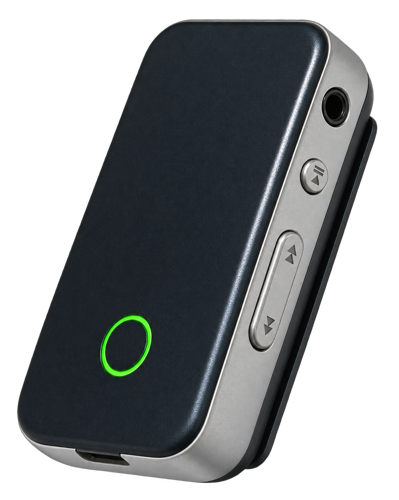

<p align="center">
  
</p>

# ES100 Control

An independent companion app for **EarStudio ES100 and ES100 MK2**, with native macOS and iPhone apps.

**[⬇ Download for macOS - latest release](https://github.com/igorgarbuz/earstudio-mac/releases/latest)**

Choose the **`.dmg` file** under **Assets**, open it, and drag **ES100 Control** into **Applications**. Requires macOS 14 or newer; works on Apple Silicon and Intel Macs. [Installation help](#download-and-install).

> **First launch:** the current app and DMG are **Developer ID signed and notarized by Apple**. Open ES100 Control normally from Applications. The DMG includes a stapled notarization ticket for offline verification.

A good DAC shouldn’t spend its retirement in a drawer. The discontinued **EarStudio ES100 and ES100 MK2** still have plenty to offer: 24-bit/48 kHz USB audio on a Mac, analog volume control and a balanced headphone output. But with the original iOS and Android apps gone from their stores, owners rediscovering their devices can lose access to the settings that make them so useful.[^app-availability] I built **ES100 Control** to give this hardware a second life. With no official open-source app to build on, I studied decompiled code from the Android APK to understand how it talks to the firmware, then wrote an independent native macOS app. See the [research provenance](Docs/Provenance.md) for the evidence behind the implementation.

Adjust the device’s equalizer, output, DAC processing, inputs, ambient/call settings and battery options from a SwiftUI interface inspired by the original Android app.

Requires **macOS 14 or newer**. Release downloads contain both **Apple Silicon and Intel** code. No audio driver or Xcode installation is needed to use the app.

This is an early community release, unaffiliated with Radsone. Physical testing has covered an ES100 running firmware 2.0.2; broader MK2 and older-firmware validation remains ongoing.

## Download and install

**Earlier downloads:** releases published before the rename contain **EarStudio Companion.app**. Use that name in the steps below when installing an older release.

1. Download the DMG from [GitHub Releases](https://github.com/igorgarbuz/earstudio-mac/releases/latest).
2. Quit any older version, open the DMG, and drag **ES100 Control** into **Applications**.
3. Eject the DMG and open the app from Applications.

### First launch on macOS

The current release is **Developer ID signed and notarized by Apple**. Open
**ES100 Control** normally from **Applications**. macOS may show its standard
confirmation that the app was downloaded from the internet.

Older, unnotarized releases may require explicit approval in System Settings →
Privacy & Security. Prefer downloading the current release. See
[Apple's instructions](https://support.apple.com/en-us/102445#openanyway) for older
copies you intentionally obtained from this project's GitHub Releases.

Each release includes a SHA-256 checksum. Download it beside the DMG and run `shasum -a 256 -c` followed by the checksum filename to verify the download.

If upgrading from **EarStudio Companion**, quit the old app, install **ES100 Control**, and remove the old **EarStudio Companion.app** from Applications to avoid keeping two copies. Existing settings and device authorization remain in the same storage locations. Older releases still use the previous name.

## Connect your EarStudio

**Pair your ES100/MK2 with this Mac in macOS Bluetooth settings before choosing Connect in ES100 Control.** Pairing with a phone or another computer does not pair it with your Mac. The companion controls settings over Bluetooth, including when you use USB for audio; connecting a USB cable alone is not enough.

1. Turn on your ES100/MK2, put it in Bluetooth pairing mode if needed, and pair it with your Mac in **System Settings → Bluetooth**. If it is already paired with this Mac, skip this step.
2. Open **ES100 Control**, allow Bluetooth access when prompted, choose **Connect**, and select your EarStudio.
3. If device authorization is requested, briefly press its power button within three minutes. This authorizes the companion app separately from macOS Bluetooth pairing. The app remembers that authorization locally for future connections; no Keychain password is needed.
4. Wait for settings to load before editing. To play Mac audio through EarStudio, select it separately in macOS Sound settings.

The app starts disconnected and sends no settings on startup. Only one app process can run at a time: opening another copy brings the existing app forward. Close other EarStudio controllers before connecting.

Device authorization tokens are stored in `~/Library/Application Support/EarStudioCompanion/device-keys.json`, with access restricted to your macOS user (directory `0700`, file `0600`). When upgrading from a version that used Keychain, press the device's power button once if prompted. The app does not read, migrate, or delete the old Keychain entry.

**Connect** handles both opening the settings connection and recovery. It first tries the existing Bluetooth link. A stalled control open waits six seconds instead of twenty, then retries the settings channel once with fresh service discovery while preserving the audio link. The app shows **Retrying settings connection** during that attempt. If both control attempts fail, or service discovery reaches its separate twenty-second deadline, it resets Bluetooth once and makes a final attempt. **Restoring Bluetooth connection** identifies this full reset, which interrupts audio. Playback may need to be resumed in the music app afterward; the companion does not control the player. **Cancel** stops the attempt. If recovery also fails, the app stops and shows the error; the same **Connect** button retries your selected device. Use **Change device** to choose another ES100.

macOS Bluetooth audio and the app’s control channel are separate connections. The ES100 can advertise a different control channel after resetting the link. Recovery preserves pairing and the saved key, never retries settings writes, and does not run after authorization or settings synchronization has started. Permission and ownership failures do not trigger a reset. A process guard prevents overlapping Companion sessions, but cannot guarantee recovery from every OS/device Bluetooth failure.

The **output mode** label reports the ES100’s amplifier mode, not confirmed headphone presence. Seeing **2.5 mm balanced** with both sockets empty is expected: the original app permits balanced mode when no 3.5 mm plug is inserted. Inserting a 3.5 mm plug selects unbalanced output.

The recovered Android protocol does not establish a separate headphone-presence flag. The app therefore does not infer “no headphones” from balanced mode: that would also mislabel an actual balanced connection. See [output-mode evidence](Docs/Protocol.md#output-mode-and-headphone-presence).

## Features

| Area | Available controls |
| --- | --- |
| Equalizer | Ten fixed bands, ±12 dB in 0.1 dB steps; enable/bypass, preamp, wide/narrow Q, headroom and analog compensation |
| Presets | 22 Android factory presets, local named presets, flat reset, JSON import/export, Android preferences XML import |
| Output | Volume/mute, four amplifier modes, output lock, left/right trim, maximum volume |
| Sound | Four DAC filters, 1×/2×/4× oversampling, crossfeed, DCT |
| Inputs | Codec/rate/bit-depth readback, AAC/aptX/aptX HD permissions, Bluetooth buffer, USB format, jitter processing |
| Ambient and calls | Ambient enable/mix/shortcut, microphone gain/preamp, call mute, loopback, hands-free profile |
| Device | Battery status/care, charging, auto power, LED, second-device reconnect, notification volume |
| Help and diagnostics | Offline explanations, connection status, refresh, diagnostic export |

Controls follow recovered firmware version gates and require their settings to have been read successfully. Every exposed settings write is confirmed by reading the actual device value; a write acknowledgement may be absent. Commands are serialized, later edits stay queued, and failed changes restore confirmed state. Writes are never retried automatically.

The EQ matches the Android app’s **graphic equalizer**: fixed center frequencies and two Q options. It does not provide arbitrary parametric bands. The plotted curve estimates the response; the ES100 processes the audio. USB-format and hands-free-profile changes require restarting the device.

Firmware flashing, factory reset, device renaming and playback transport controls are not included. An iPhone companion, **ES100 Control**, is also included and has been tested successfully on a physical iPhone with EarStudio hardware. See [iPhone development](Docs/iOS.md).

## Preset compatibility

**EQ → Presets → Factory presets** contains the 22 recovered Android factory curves, including Flat. Selecting one applies its ten band gains and 0 dB preamp while preserving Q, headroom, analog compensation and EQ enable/bypass. Factory presets are separate from your saved library; use **Save current as preset…** to save a customized copy. The separate **Reset to flat** action retains its existing full-preset behavior.

Connection reads the device’s active EQ, including settings previously applied from Android. Both apps identify matching saved and factory presets from these values after reconnecting or restarting. Checkmarks indicate matching settings, not a stored preset identity: identical presets can all match. Saved presets compare gains, preamp, and supported processing options; factory presets compare gains and preamp only. The Android app’s four saved presets are separate phone-local data. If you have an exported SharedPreferences XML containing `radsone_eq_pre1`–`radsone_eq_pre4`, use **Import EQ Presets**. The app does not extract a phone’s private storage.

Android slots contain preamp and ten band gains, but omit Q/headroom. Imported slots default to narrow Q, −6 dB headroom and analog compensation enabled; review these before applying. Mac JSON exports preserve these settings. Importing updates the local library; applying a preset changes the device.

## Build from source

Install full Xcode and select it under **Xcode → Settings → Locations → Command Line Tools**. The project was tested with Xcode 26.3 and has no third-party package dependencies.

```sh
git clone https://github.com/igorgarbuz/earstudio-mac.git
cd earstudio-mac
open EarStudioCompanion.xcodeproj
```

Choose the **EarStudioCompanion** scheme and **My Mac**, then press **⌘R** to run or **⌘U** to test. From the cloned repository, the CLI equivalents are:

```sh
./Tools/build.sh build    # Developer ID signed universal Release app
./Tools/build.sh test     # Native XCTest suite
swift test --package-path Packages/EarStudioKit  # Shared core/session tests
./Tools/check-ios-package.sh                    # Compile shared modules for iOS Simulator
./Tools/package.sh        # Signed, notarized app/DMG and checksum
./Tools/install-ios.sh    # Detect iPhone/team, build, sign and install locally
```

`build.sh` defaults to `build` and does not create a DMG. Set `MARKETING_VERSION` deliberately in each app’s `Configuration/App.xcconfig`. iPhone installs and macOS release builds/archives automatically reserve the next build number and embed the Git revision plus a modified marker. Tests and compile-only iOS builds do not reserve numbers. See [build numbering](Docs/Maintaining.md#build-numbering).

Generated apps, archives and logs go into the ignored build directory; DMGs and checksums go into the ignored dist directory. macOS Release builds and packaging require a valid **Developer ID Application** certificate and private key in the Keychain, with hardened runtime and a secure timestamp. The scripts detect a unique identity, or accept `APPLE_TEAM_ID` and `MACOS_SIGN_IDENTITY` to select one. Tests use ad-hoc signing; contributors and CI can explicitly run `./Tools/build.sh build --ad-hoc` or `./Tools/package.sh --ad-hoc`. Public packaging and publishing require Developer ID signing and Apple notarization using the `earstudio-notary` Keychain profile. Packaging staples and validates the ticket before generating the checksum; publishing checks it again. See [notarization setup](Docs/Maintaining.md#notarization). See [signing setup](Docs/Maintaining.md#signing-local-builds).

The checked-in Xcode project is ready to open. The optional project generator is only needed after adding/removing files outside Xcode: run `python3 Tools/generate_project.py`. Build settings belong in the xcconfig files; regeneration replaces manual project/scheme edits.

## Publish a release

Prepare a pull request updating the version and build number in **Apps/macOS/Configuration/App.xcconfig** and adding version-specific notes under **Docs/Releases**. After review, passing CI, and merging, switch to `main` in a clean local checkout and run `git pull --ff-only`. With [GitHub CLI](https://cli.github.com/) installed and authenticated using `gh auth login`, run:

```sh
./Tools/publish-release.sh --dry-run
./Tools/publish-release.sh
```

The script requires a clean checkout whose commit matches the remote default branch. It refuses existing tags/releases, runs both test suites, builds and verifies a fresh universal DMG, and uploads the DMG and checksum to a draft release targeting that exact commit. It checks the uploaded assets before publishing. A failed upload leaves a draft for inspection; an existing release is never overwritten. An optional `--notes-file` selects a different release-notes file.

## Contributing

Bug reports, feature requests, documentation fixes, and focused pull requests are welcome. See [CONTRIBUTING.md](CONTRIBUTING.md) for the fork/PR workflow, development setup, and validation commands, and follow the [Code of Conduct](CODE_OF_CONDUCT.md). Igor (`@igorgarbuz`) reviews and merges contributions; changes to `main` go through PRs and CI.

Report suspected vulnerabilities privately using [SECURITY.md](SECURITY.md). [Maintainer guidance](Docs/Maintaining.md) documents branch protections, repository settings, and the release process.

## Project and protocol documentation

The repository contains the shipping macOS app and the **ES100 Control** iPhone companion, both using the local `Packages/EarStudioKit` Swift package. `EarStudioCompanion.xcodeproj` remains the macOS entry point. Platform code and signing configuration live under `Apps/macOS`; `Apps/iOS` contains the iPhone app, with its own `EarStudioiOS.xcodeproj` entry point and simulator UI tests. See [iPhone development](Docs/iOS.md) for build instructions and hardware validation limits.

`EarStudioCore` owns the protocol, settings and presets. `EarStudioSession` owns authentication, command scheduling and readback reconciliation behind an injected transport. `EarStudioUI` provides shared bindings, theme, product image and EQ chart; `EarStudioAssets` owns the resource bundle. Shared tests run through SwiftPM, and native integration tests run through Xcode. See [Architecture](Docs/Architecture.md) for ownership, dependency rules and platform adapters.

- [Protocol reference](Docs/Protocol.md): framing, authentication, commands, units, reply layouts and firmware gates.
- [Control audit](Docs/ControlAudit.md): every exposed setting’s write/read mapping, corrections and validation limits.
- [Provenance](Docs/Provenance.md): source identities and evidence scope.

Regression tests cover protocol fixtures, every control against simulated firmware, unchanged neighboring fields, optional acknowledgements, signed units, firmware boundaries, queued edits, connection cleanup and process ownership. They complement hardware testing; they do not establish physical behavior of every setting or compatibility with every firmware version.

Report bugs through [GitHub Issues](https://github.com/igorgarbuz/earstudio-mac/issues), including app/macOS/device firmware versions, reproduction steps and sanitized diagnostics. Exclude authentication keys and personal Bluetooth identifiers.

## Manuals and technical references

The original Radsone PDFs are preserved here for owners who want to explore the hardware and its settings. These documents describe the original ES100 and date from 2017–2018; details may differ on the MK2 or other firmware versions.

| PDF | What it covers |
| --- | --- |
| [ES100 manual](Docs/Reference/es100-manual.pdf) | Buttons, LEDs, pairing, app settings and firmware updates. |
| [ES100 quick start guide](Docs/Reference/es100-quick-start.pdf) | Physical controls, connections and first-time pairing. |
| [Technologies and main features](Docs/Reference/technologies-and-features.pdf) | CSR8675 Bluetooth processor, dual AK4375a DACs, USB and DSP architecture. |
| [AK4375a DAC digital filters](Docs/Reference/dac-digital-filter.pdf) | Filter options and their measured responses. |
| [Analog volume control](Docs/Reference/analog-volume-control.pdf) | Programmable gain amplifier design and volume measurements. |
| [DualDrive technology](Docs/Reference/dualdrive-technology.pdf) | Dual DAC/amplifier design and balanced versus single-ended outputs. |
| [Preamplifier application note](Docs/Reference/preamplifier.pdf) | Connecting the ES100 to an amplifier and estimating output levels. |
| [Performance evaluation](Docs/Reference/performance-evaluation.pdf) | Manufacturer measurements of the 3.5 mm single-ended output. |

The six technical PDFs are Radsone application notes and reports, rather than chip datasheets. Standalone AKM AK4375A and Qualcomm CSR8675 datasheets are not included in the available collection. Firmware-update instructions in the manual refer to the original tools; this companion does not flash firmware.

## License

The independently authored code, tests, documentation and app icon are [MIT licensed](https://github.com/igorgarbuz/earstudio-mac/blob/main/LICENSE). The Radsone PDFs in `Docs/Reference` are third-party materials and are not covered by that license. The product photo shared by the README and both apps was taken and supplied by the project owner. Vendor Android binaries and decompiled material are not distributed in this repository or its app. EarStudio and other product names belong to their respective owners.

[^app-availability]: App availability checked in October 2026: [AppBrain’s Android listing](https://www.appbrain.com/app/earstudio/com.dealon.earstudio) records removal from Google Play in May 2025; [Soft112’s iOS listing](https://earstudio-ios.soft112.com/earstudio-ios-alternatives.html) reports removal from the App Store. These records do not establish when or why Radsone ceased operations.
